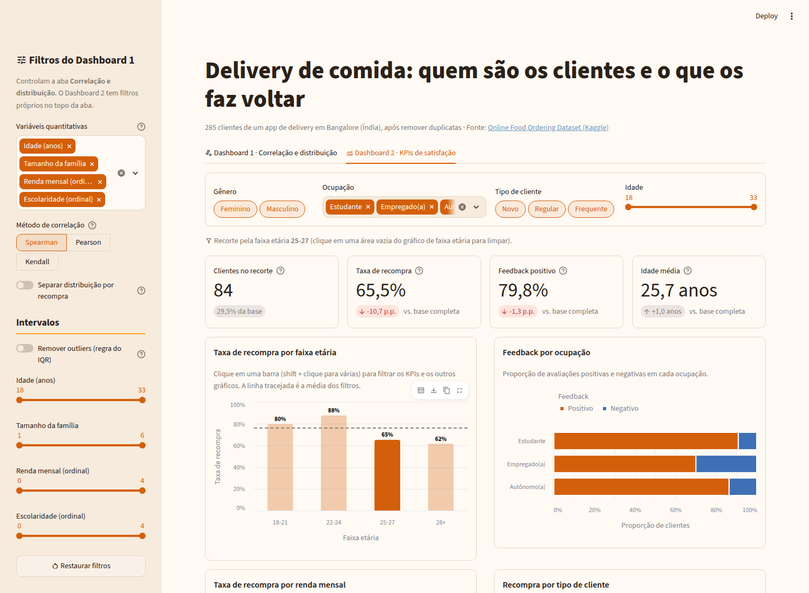
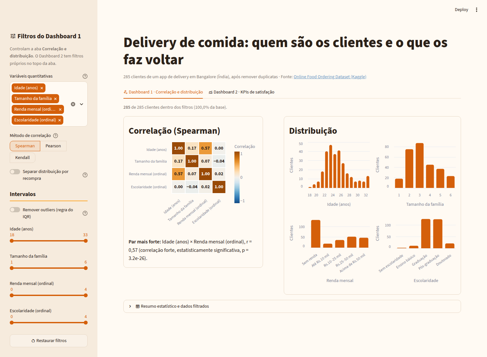

# Delivery de comida: quem são os clientes e o que os faz voltar

Dashboards interativos em **Streamlit** construídos a partir da minha análise exploratória (EDA) do [Online Food Ordering Dataset](https://www.kaggle.com/datasets/srisyra02/online-food-ordering-dataset): 285 clientes de um aplicativo de delivery em Bangalore, Índia.

**Repositório GitHub:** [AVD-20262-pratica-streamlit](https://github.com/caioleimig/AVD-20262-pratica-streamlit)

**Aplicação publicada:** [Acessar dashboards no Streamlit Community Cloud](https://avd-delivery-caioleimig.streamlit.app/)

Projeto desenvolvido para a disciplina **Análise e Visualização de Dados**, na CESAR School (2026.2), como parte das atividades das Aulas 21 a 23.

**Aluno:** Caio Leimig Rodrigues da Silva



## O que o app mostra

O aplicativo possui duas abas:

| Aba | Pergunta | Conteúdo |
|---|---|---|
| **Dashboard 1 · Correlação e distribuição** | Como as variáveis quantitativas se relacionam e se distribuem? | Heatmap de correlação (Spearman, Pearson ou Kendall) com o par mais forte e o p-valor, histogramas por variável, sliders de intervalo e remoção de outliers pela regra do IQR. |
| **Dashboard 2 · KPIs de satisfação** | Quem pediria novamente e quem está insatisfeito? | 4 KPIs (clientes, taxa de recompra, feedback positivo e idade média) com delta contra a base, além de 4 visualizações Altair. **Clicar em uma faixa etária filtra os KPIs e os gráficos** por meio de seleção cruzada. |

### Principais achados

Resultados provenientes da análise exploratória e apresentados nos dashboards:

- A taxa de recompra cai de aproximadamente 80–88% (até 24 anos) para 62–65% a partir dos 25 anos.
- Empregados e autônomos apresentam a maior proporção de feedback negativo (Qui-quadrado: ocupação × feedback, p ≈ 0,011).
- Idade e renda formam o par com a correlação mais alta do conjunto (Spearman ≈ 0,57, moderada). Cerca de metade da base é de estudantes (144 de 285), e 122 deles não têm renda.
- Os resultados mostram associações entre as variáveis, não relações de causa e efeito. A amostra é de um único app em uma cidade (285 clientes).



## Tecnologias utilizadas

- **Python 3.12** e **Streamlit 1.66**: desenvolvimento da aplicação, abas, sidebar, indicadores (`st.metric`) e cache (`@st.cache_data`).
- **Altair**: construção dos gráficos e implementação da seleção cruzada com `on_select="rerun"`.
- **pandas e SciPy**: tratamento dos dados, correlações e testes de significância estatística.
- **Jupyter Notebook**: análise exploratória e pipeline de preparação dos dados.
- **Streamlit Community Cloud**: publicação dos dashboards.

## Estrutura do repositório

```text
├── app.py
├── src/
│   ├── data_loader.py
│   ├── config.py
│   └── graficos.py
├── data/
│   ├── raw/
│   └── clean/
│       └── dataset.csv
├── notebooks/
│   ├── eda.ipynb
│   ├── eda-com-downloads.ipynb
│   └── arquivo-eda-original.ipynb
├── entregas/
├── prompts/
├── tests/
│   └── test_app.py
├── docs/
│   └── img/
├── .streamlit/
│   └── config.toml
├── .vscode/
├── requirements.txt
├── requirements-dev.txt
├── README.md
├── ROTEIRO.md
└── ALTAIR-CROSSFILTER.md
```

### Principais diretórios e arquivos

- `app.py`: aplicação Streamlit com os dois dashboards.
- `src/data_loader.py`: leitura do dataset tratado, com `@st.cache_data`.
- `src/config.py`: rótulos, ordens de categorias e cores.
- `src/graficos.py`: funções responsáveis pela construção dos gráficos Altair.
- `data/raw/`: armazenamento do dataset original, não versionado.
- `data/clean/`: armazenamento do dataset tratado e versionado.
- `notebooks/`: notebooks de análise exploratória e preparação dos dados.
- `entregas/`: wireframes, justificativas e materiais das entregas acadêmicas.
- `prompts/`: prompts utilizados e declaração de uso de inteligência artificial.
- `tests/`: testes automatizados da aplicação.
- `docs/img/`: imagens dos dashboards utilizadas na documentação.

## Como executar localmente

Requer **Python 3.11 a 3.15**.

### 1. Clonar o repositório

```bash
git clone https://github.com/caioleimig/AVD-20262-pratica-streamlit.git

cd AVD-20262-pratica-streamlit
```

### 2. Criar e ativar o ambiente virtual

```bash
python -m venv .venv
```

No Windows (PowerShell):

```powershell
.venv\Scripts\Activate.ps1
```

No Linux ou macOS:

```bash
source .venv/bin/activate
```

### 3. Instalar as dependências

```bash
python -m pip install -r requirements.txt
```

Para instalar também as dependências de desenvolvimento e utilizar os notebooks:

```bash
python -m pip install -r requirements-dev.txt
```

O projeto também utiliza o comando abaixo para disponibilizar as instruções oficiais de desenvolvimento do Streamlit para ferramentas de IA:

```bash
streamlit skills --yes
```

### 4. Executar a aplicação

```bash
streamlit run app.py
```

### 5. Executar os testes (opcional)

```bash
python tests/test_app.py
```

## Análise exploratória e preparação dos dados

O projeto utiliza três notebooks principais:

- `eda.ipynb`: análise exploratória original realizada anteriormente na disciplina.
- `eda-com-downloads.ipynb`: pipeline de download, tratamento, análise e exportação do dataset.
- `arquivo-eda-original.ipynb`: notebook de referência disponibilizado pela professora.

Para regenerar o dataset tratado, execute `notebooks/eda-com-downloads.ipynb` do início ao fim. O notebook baixa o CSV original para `data/raw/` e exporta a versão tratada para `data/clean/dataset.csv`.

## Dados: `data/raw/` e `data/clean/`

| Pasta | Versionada? | Conteúdo |
|---|---|---|
| `data/raw/` | Não (somente `.gitkeep`) | CSV original do Kaggle, com 388 linhas. |
| `data/clean/` | Sim | Dataset tratado, com 285 linhas. |

O tratamento incluiu:

- Remoção de registros duplicados.
- Exclusão da coluna redundante `Unnamed: 13`.
- Limpeza de espaços extras.
- Tradução de categorias para português.
- Criação das variáveis `faixa_etaria`, `renda_nivel` e `escolaridade_nivel` (ordinais de 0 a 4).
- Remoção das colunas `Pin code`, `latitude` e `longitude`.

O dataset é público e disponibilizado no Kaggle. Não contém nomes, documentos ou contatos pessoais. O CSV original traz latitude e longitude (centroides de áreas de CEP, não endereços); mesmo assim, essas coordenadas foram removidas do dataset tratado por precaução, já que a aplicação não as utiliza nem apresenta mapas.

**Sobre a variável `Output`:** o dataset não documenta formalmente essa coluna. Neste projeto, seguimos a interpretação mais comum de que `Yes` indica que o cliente pediria novamente pelo aplicativo, representada pela variável `pede_novamente` no dataset tratado.

## Entregas da atividade

- **Wireframes dos dashboards:**
  - [Wireframe do Dashboard 1](entregas/wireframe-dashboard1.png)
  - [Wireframe do Dashboard 2](entregas/wireframe-dashboard2.png)
- **Justificativa das métricas:** [justificativa-metricas.md](entregas/justificativa-metricas.md)
- **Evidências de testes e validação:** [docs/testes.md](docs/testes.md)
- **Declaração de uso de IA (assinada):** [DECLARACAO_IA.pdf](prompts/DECLARACAO_IA.pdf) · resumo em [declaracao-uso-ia.md](prompts/declaracao-uso-ia.md)
- **Roteiro das aulas:** [ROTEIRO.md](ROTEIRO.md)

## Utilização de inteligência artificial

O desenvolvimento contou com apoio de ferramentas de inteligência artificial, incluindo o uso do **Streamlit Skills**, conjunto de instruções que orienta ferramentas de IA na utilização da API atual do Streamlit.

O comando `streamlit skills --yes` cria as pastas `.claude/skills/` (Claude Code) e `.agents/skills/` (Gemini CLI) como links simbólicos para o ambiente virtual. Por esse motivo, essas pastas não são versionadas: cada pessoa deve executar o comando no próprio ambiente.

O uso de inteligência artificial está documentado na declaração assinada [prompts/DECLARACAO_IA.pdf](prompts/DECLARACAO_IA.pdf) (resumo em [prompts/declaracao-uso-ia.md](prompts/declaracao-uso-ia.md)). No Dashboard 2, as quatro métricas foram escolhidas em colaboração com a IA, e a primeira versão da justificativa foi redigida por ela. Os registros dos pedidos feitos à IA, reconstruídos depois do uso (não são transcrições literais), estão em [prompts/](prompts/).